# Настройки сервера #

1. [Темы](#темы)
2. [Магазин](#магазин)
3. [Карты](#карты)
4. [Технический перерыв](#тех-перерыв)

В этом файле будет описано как настраивать некоторые функции в сервере, их возможности и т.д.\
Здесь будет рассказано о разновидностях фонов, о создании новых акций в магазине, о изменении ротации карт, о випках, о креаторах, тех. перерыве и т.д.

1. ## Темы
Под этим подразумевается смена оформления фона на главном меню в игре. Настраивается в корне проекта в config.json, переменная ThemeID.\
Всего есть 12 тем:

1) Стандартная:\
Тут нечего сказать.\
"ThemeID": 0\
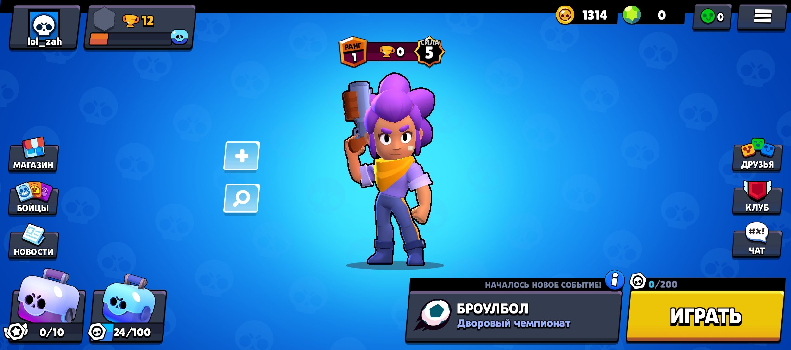

2) Стандартная + частицы снега:\
К стандартной теме добавились движущиеся частички снега, новогодний вайб.\
"ThemeID": 1\

3) "Красный новый год":\
Красненький фон и иконки со свинюшками, мило.\
"ThemeID": 2\

4) "Клеш Рояль":\
Тут нечего сказать.\
"ThemeID": 3\
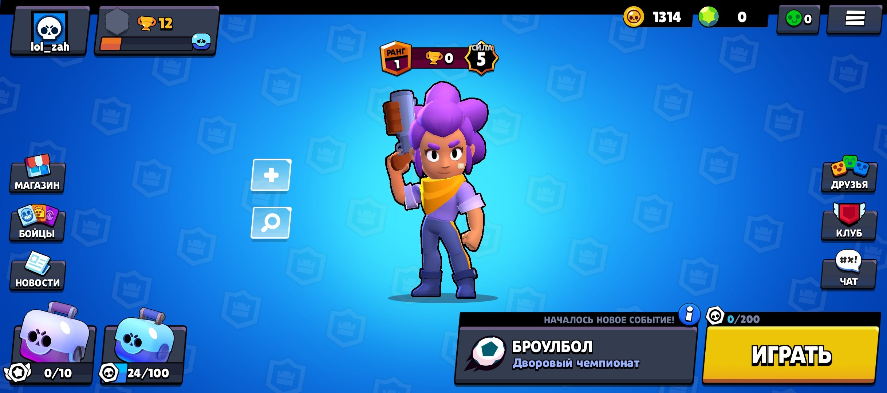

5) Стандартная:\
Скорей всего такого нет, но как промежуточный пускай валяется, может быть коректнее использовать этот ID, а не 0.\
"ThemeID": 4\
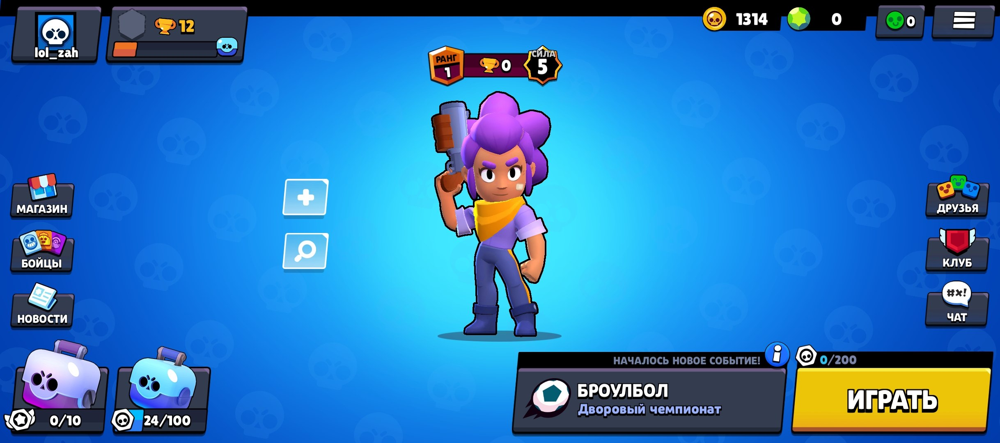

6) Жёлто-оранжевый фон с пандами:\
Не менее милый фон с иконками панд на фоне.\
"ThemeID": 5\
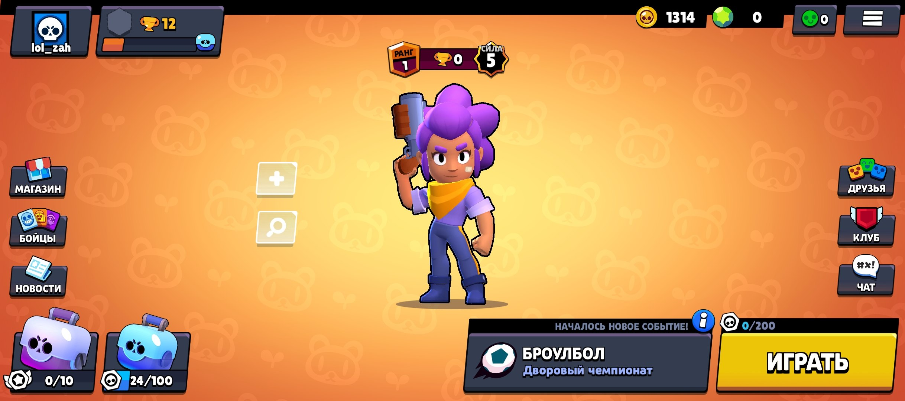

7) Фиолетовый фон с иконками Булла:\
Тут нечего сказать.\
"ThemeID": 6\
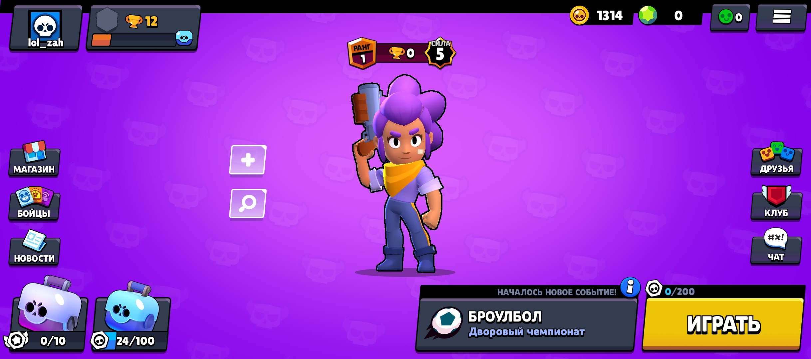

8) Зелёный фон с иконками роботов:\
Тут нечего сказать.\
"ThemeID": 7\
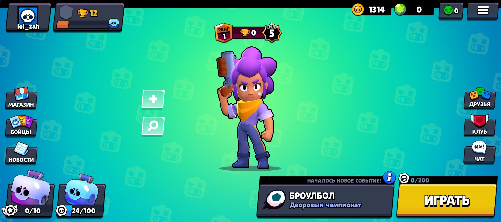

9) Фиолетовый фон с иконками призрака:\
Тут нечего сказать.\
"ThemeID": 8\
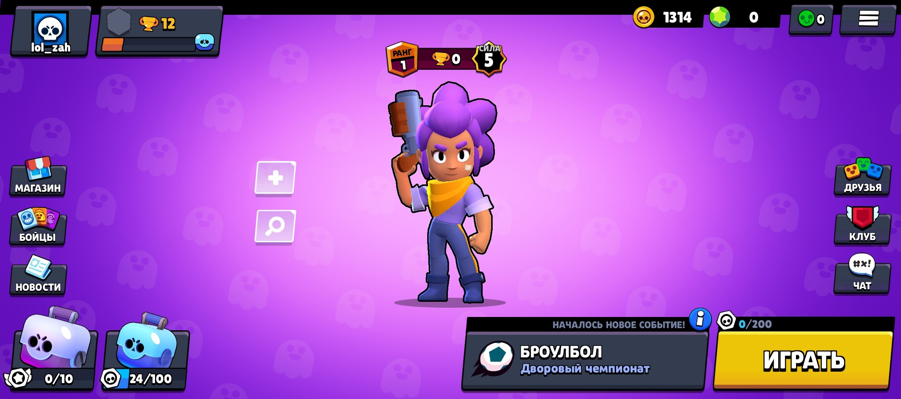

10) Пиратский фон:\
Тут нечего сказать.\
"ThemeID": 9\
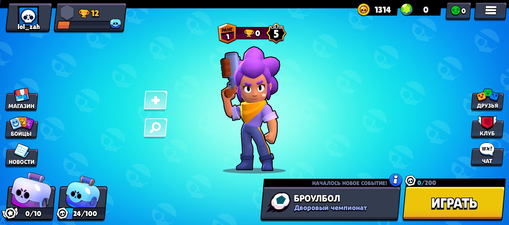

11) Красный фон с чем-то:\
Тут нечего сказать.\
"ThemeID": 10\
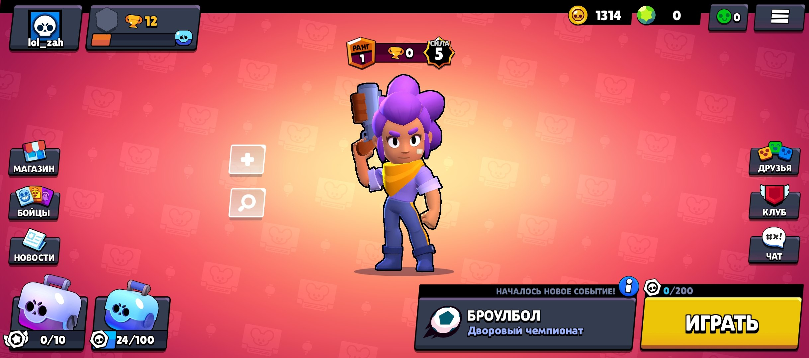

12) Зелёный футбольный фон:\
Тут нечего сказать.\
"ThemeID": 11\
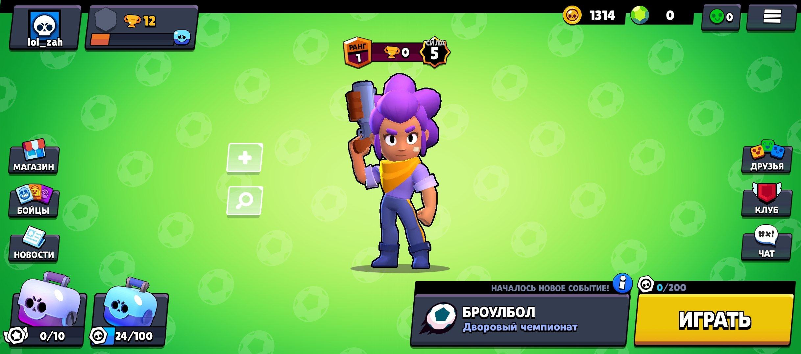

2. ## Магазин

Все акции с сервера хранятся в offers.json. Акции завязаны на времени сервера.
1) [Описание конструкции акции в offers.json](#описание-конструкции-акции-в-offersjson)
2) [Полный пример акции](#полный-пример)
3) [Монеты](#монеты)

### Описание конструкции акции в offers.json
1) [ID](#id)
2) [OfferTitle](#offertitle)
3) [Cost](#cost)
4) [OldCost](#oldcost)
5) [Multiplier](#multiplier)
6) [BrawlerID](#brawlerid)
7) [SkinID](#skinid)
8) [WhoBuyed](#whobuyed)
9) [Timer](#timer)
10) [OfferBGR](#offerbgr)
11) [ShopType](#shoptype)
12) [ShopDisplay](#shopdisplay)
13) [StartTime](#starttime)

#### ID
ID - числовое значение, которое обозначает тип акции.\
Все типы акций:\
0 - бесплатный маленький ящик?;\
1 - монеты;\
2 - случайный боец (награда пути к славе? я не понял, как этим пользоваться пока что);\
3 - боец;\
4 - скин;\
5 - Звёздная сила (пасивка или гаджет?);\
6 - маленький ящик;\
7 - билеты событий (для событий по билетам);\
8 - очки силы;\
9 - удвоитель жетонов;\
10 - мегаящик;\
11 - игра вылетает;\
12 - очки силы;\
13 - игра вылетает;\
14 - большой ящик;\
15 - игра вылетает;\
16 - гемы.

#### OfferTitle
OfferTitle - название акции.\
"OfferTitle": "TEST"

#### Cost
Cost - цена.\
"Cost": 10

#### OldCost
OldCost - старая цена (типо Cost - новая цена "со скидкой").\
"OldCost": 100

#### Multiplier
Multiplier - сколько получишь награды в акции.

#### BrawlerID
BrawlerID - ID бравлела, которого можно получить при 3 ID акции.

#### SkinID
SkinID - ID скина, при 4 ID акции.

#### WhoBuyed
WhoBuyed - кто купил акцию по ID людей.

#### Timer
Timer - время работы акции в секундах, после того, как время пройдёт - акции не будет видно в магазине.\
"Timer": 60

#### OfferBGR
OfferBGR - фон акции, в примере на акции будет зелёный фон с иконками гемов.\
"OfferBGR": "offer_gems"

#### ShopType
ShopType - тип валюты для оплаты:\
0 - гемы;\
1 - монеты;\
2 - какой-то смотреть.. не покупается..\
"ShopType": 0

#### ShopDisplay
ShopDisplay - тип акции.\
0 - стандартная акция;\
1 - Акция дня.\
"ShopDisplay": 0

#### StartTime
StartTime - время начала акции.\
"StartTime": 0

### Полный пример

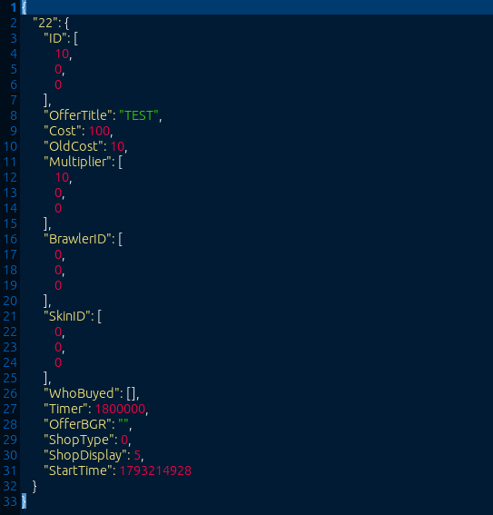

### Монеты
В магазине есть покупка монет за гемы, цена монет и их количество задаётся в Logic/dshop.json.\
Я поставил 300 монет за 30 гемов.\

Пытался разобраться с жетонами удвоения, в итоге походу не получилось.

3. ## Карты

4. ## Тех. перерыв

Технический перерыв включается с помощью пременной Maintenance. Два значения: "Maintenance": true и "Maintenance": false.
Также можно назначить время перерыва в секундах с помощью переменной MaintenanceTime. На пример "MaintenanceTime": 3600, это час тех. перерыва.
При изменении переменной на true, игроки, которые зайдут в игру увидят табличку с перерывом.
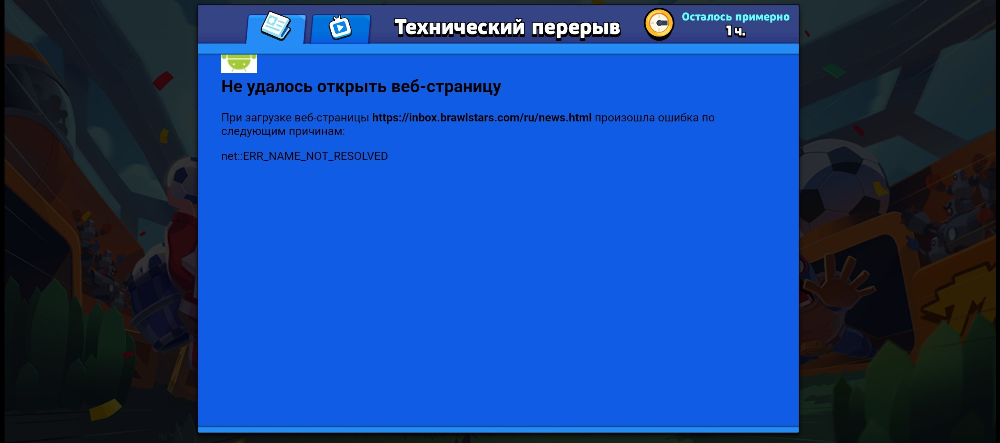

Те игроки, которые остались в игре, останутся там, но не на долго.
После конца перерыва появляется кнопка "Попробовать сверху" завместо примерного отсчёта до конца перерыва.
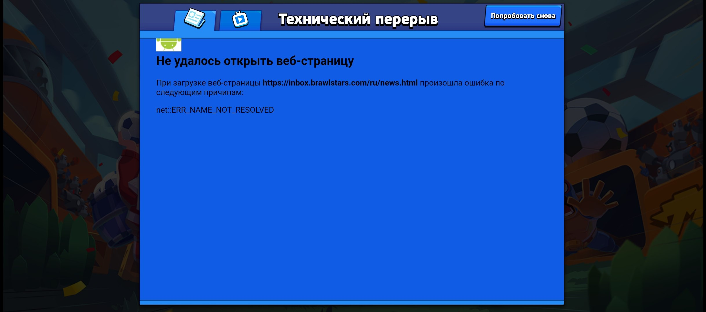

При нажатии кнопки или просто перезапуска игры, будет обычный запуск игры, как и всегда.
